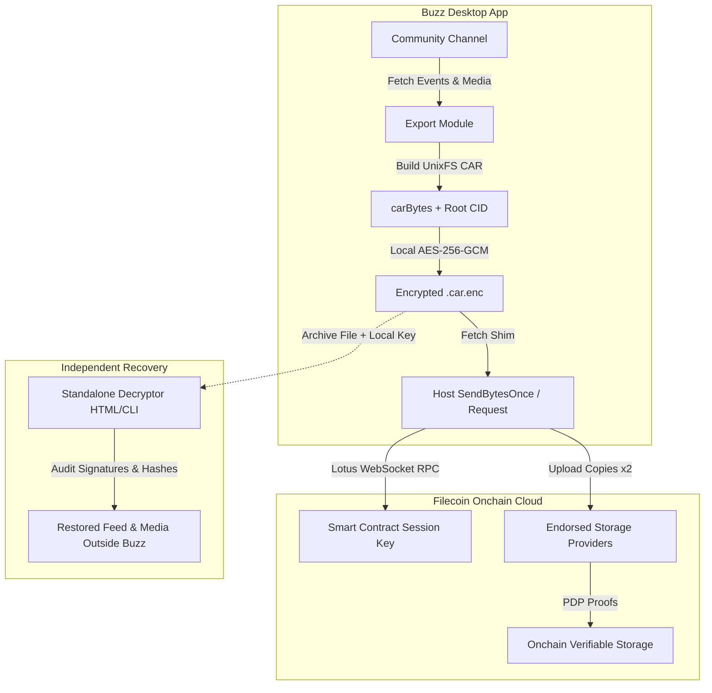

# Buzz Vault

> **Encrypted, verifiable channel archiving to Filecoin Onchain Cloud for Block's Buzz desktop client.**

Buzz Vault is a desktop plugin for [Buzz](https://github.com/block/buzz) (Block’s open-source, Nostr-based collaboration app) that lets community owners take cryptographically signed, encrypted snapshots of channel history and media attachments, preserve them across independent decentralized storage providers (SPs) on Filecoin, and audit or open them completely outside Buzz.

---

## The Problem: Ephemeral Chat and Vendor Lock-in

Whether running on centralized platforms (Slack, Discord) or federated protocols (Nostr relays), team and community communication faces fundamental data persistence risks:

1. **Centralized Platform Rents & Lock-in:** Slack and Discord hold institutional knowledge hostage behind proprietary subscription tiers and retain the power to de-platform communities or delete historical archives.
2. **Relay Eviction & Data Loss:** In federated ecosystems like Nostr, relays are lightweight routing nodes, not permanent storage archives. Relays regularly prune event history to conserve disk space, drop offline, or lose external media attachments hosted on ephemeral image servers.
3. **Unverifiable History:** When backups are made, traditional exports are flat JSON files with no cryptographic proof of who authored what, when it occurred, or whether attachments were tampered with.

---

## What Buzz Vault Does

Buzz Vault bridges Block's Buzz communication client with Filecoin Onchain Cloud (`@filoz/synapse-sdk`):

- **Cryptographic Preservation:** Captures signed Nostr channel events (Kind 9) preserving original author Schnorr signatures intact. Every message is verifiable and non-repudiable.
- **Media Preservation:** Discovers inline attachments from event metadata (`imeta`), downloads the raw binary blobs, audits their SHA-256 hashes, and bundles them alongside messages.
- **Content-Addressable Packaging:** Packs the event stream, attachment tree, and coverage manifest into an IPLD/UnixFS CARv1 (Content Addressable Archive).
- **Client-Side Encryption:** Encrypts the CAR package locally on the user's machine using AES-256-GCM (`filecoin-encryption-envelope`) before any network transmission. Neither storage providers, relays, nor third parties can read community data.
- **Decentralized Storage:** Uploads redundant copies across independent Filecoin Calibration storage providers with onchain storage agreements and Proof of Data Possession (PDP).
- **Onchain Audit Receipt:** Posts a verifiable receipt message back into the channel with the Piece CID, root CID, transaction hash, and active storage providers.
- **Independent Recoverability (Zero Vendor Lock-in):** If Buzz servers, relays, or the desktop client ever disappear, a community owner can open the encrypted archive using a zero-dependency static web decryptor (`tools/decryptor.html`) or CLI without Buzz or Filecoin installed.

---

## Turn Seal

When a local agent's turn finishes, Buzz Vault seals it to Filecoin with no click. The trigger is `session.agentActivity`: a turn is sealed once it reports `done`, nothing is still publishing, and it has at least one published reply.

For each finished turn the plugin:

1. Collects the signed request event and the agent's reply events, from its live event buffer first and a relay read for the rest.
2. Verifies each event's NIP-01 id and Schnorr signature.
3. Writes a plaintext CAR with two files: `events.ndjson` (the signed events) and `manifest.json` (agent, channel, request id, event ids, signature counts, and what was omitted).
4. Uploads two copies to Filecoin Calibration providers via the Synapse SDK.
5. Posts a card in the request thread:

   > **Scribe finished** · 2 signed messages verified · saved on Filecoin Calibration, data set 52644 · 2 copies
   > Open result · piece `bafkzcibd4qeq…hd5dqn`
   > `<root CID> https://<provider>/public/<piece CID>`

   The last line carries the full root CID and the `/public/` piece URL so [buzz-cid-card](https://github.com/SgtPooki/buzz-cid-card) can fetch the CAR and render a verified preview of the root.

The seal records what the agent said, not what it did. It omits tool calls, filesystem changes, and attachment bytes, and `manifest.json` lists those omissions.

### Reading a seal

- **`vault_turn_get` agent tool:** takes a piece CID (and an optional URL when the seal is not in this device's index), fetches the piece, checks that `Piece.calculate` over the bytes matches the CID, verifies every signature, and returns the transcript.
- **Web viewer:** "Open result" links to `https://sgtpooki.github.io/buzz-vault/viewer.html?piece=<piece CID>&src=<provider URL>`. The page fetches the CAR, unpacks it, and verifies every id and signature in the browser. It is built from `src/viewer.ts` by `pnpm build:viewer` into `docs/viewer.js`, with no CDN imports (an earlier esm.sh version never finished loading in Chrome). It does not recompute the piece CID ([#8](https://github.com/SgtPooki/buzz-vault/issues/8)).

---

## How It Works



---

## Project Structure

```text
buzz-vault/
├── manifest.json            # Buzz plugin manifest declaring host capabilities (incl. dynamicUploads)
├── src/
│   ├── index.tsx            # Plugin entry point (settings card, panel, agent tools, turn seal watcher)
│   ├── connect.ts           # Session key generation, console auth, and host file auto-detection
│   ├── export.ts            # Nostr event fetching, media bundling, and UnixFS CAR builder
│   ├── encrypt.ts           # AES-256-GCM envelope encryption via filecoin-encryption-envelope
│   ├── upload.ts            # Synapse SDK client and host fetch shim for binary PDP uploads
│   ├── receipt.ts           # Receipt formatting and channel publication
│   ├── seal.ts              # Turn Seal: watch agent turns, build the seal CAR, upload, post the card
│   ├── verify.ts            # NIP-01 id and Schnorr signature verification
│   ├── read-car.ts          # Reads a seal CAR back into events and manifest
│   ├── viewer.ts            # Browser entry for the standalone seal viewer
│   ├── agent-tool.ts        # 'vault_archive' and 'vault_turn_get' agent tools
│   └── ui/
│       ├── SettingsCard.tsx # Filecoin connection UI (Console, File auto-detect, File upload, Paste)
│       └── VaultPanel.tsx   # Channel archive trigger and real-time status monitor
├── tools/
│   ├── decryptor.html       # Standalone zero-dependency web decryptor
│   ├── decryptor.ts         # Standalone CLI decryptor
│   └── recovery-drill.ts    # End-to-end cryptographic integrity verification drill
├── docs/                    # GitHub Pages: seal viewer (viewer.html, bundled viewer.js) and drill runbook
├── .review/                 # Evidence from live runs (notes, scripts, screenshots, video)
├── test/                    # Vitest test suite
├── vite.viewer.config.ts    # Bundles src/viewer.ts into docs/viewer.js
└── buzz-app-host-upload.patch # Patch to the Buzz host app (see below)
```

---

## Getting Started

### Prerequisites

- Node.js >= 24
- `pnpm` >= 10
- Built version of Block's `buzzodz` CLI (from `buzz-app`)
- A funded Filecoin Calibration session (via [Filecoin Pay Console](https://pay.filecoin.cloud) or local `filecoin-pin`)

### 1. Build the Plugin

```bash
pnpm install
pnpm build
```

This compiles TypeScript and bundles the plugin into `dist/plugin.js` and `dist/manifest.json`.

### 2. Sideload into Buzz

```bash
buzzodz plugin install dist
buzzodz plugin list
```

Verify that `sgtpooki.buzz-vault` is listed as `enabled (external)`.

### 3. Connect to Filecoin Calibration

Open Buzz, navigate to **Settings -> Buzz Vault**. You have 3 connection options:

1. **Auto-Detect (Fastest):** If you have used `filecoin-pin` on your machine, Buzz Vault detects your local session at `~/Library/Application Support/filecoin-pin/session.env` and connects with a single click.
2. **Filecoin Console (Browser Wallet):** Click **"Connect with Filecoin Console"** to generate a session key and authorize via MetaMask / browser wallet on Calibration testnet.
3. **File Import / Paste:** Select or drag-and-drop an existing `session.env` file or paste its contents directly.

### 4. Archive a Channel

- **From the UI:** Open any community channel, open the Buzz Vault panel, and click **"Archive Channel to Filecoin"**.
- **Via Buzz AI Agents:** Ask any Buzz agent:
  > *"Archive channel #announcements to Filecoin with local encryption."*
  The agent will invoke the registered `vault_archive` tool, read attachments, build the archive, upload to Filecoin, and post the receipt back to the conversation.

---

## Independent Recovery Drill

To verify that archives can be decrypted and audited without Buzz:

```bash
pnpm exec tsx tools/recovery-drill.ts
```

This runs an automated end-to-end drill:
1. Generates Nostr channel events with valid Schnorr signatures and image attachments.
2. Exports to a UnixFS CARv1 archive.
3. Encrypts the CAR with a fresh AES-256-GCM key and writes it to disk.
4. Reads the encrypted file from disk, decrypts with `decryptCar`, unpacks blocks, and verifies 100% of cryptographic signatures and attachment hashes.

To inspect archives visually, open `tools/decryptor.html` in any web browser and load the `.car.enc` file with the hex key.

---

## Testing

```bash
pnpm test
```

Runs the 58-test vitest suite covering:
- Host fetch shimming and upload sequence dispatch.
- Session key parsing, registry log polling, and candidate path resolution.
- Nostr event serialization, `imeta` parsing, and CAR construction.
- Encryption envelopes and signature auditing.
- Receipt formatting with strict placeholder prohibition.
- Turn Seal: signature verification, sealable turns, event collection, seal CAR round-trip, card format, and upload-once card retry.

---

## Host Patch

`buzz-app-host-upload.patch` applies to the Buzz host app. It adds `host.sendBytesOnce` (a single raw-bytes PUT/POST) and extends `host.request` and `host.requestBytes` to dynamic public HTTPS origins when the plugin manifest sets `host.dynamicUploads`. It also adds the `allow-plugin-host-send-bytes-once` capability. Storage provider origins are not known ahead of time, so the plugin cannot declare them in its manifest.

---

## Operational Notes

- The Claude harness in Buzz needs an Anthropic API key saved in Buzz settings. The Codex harness uses the local `codex` login. The seal itself is harness-agnostic.
- Storage provider `/piece/` URLs redirect to `/public/`, and the host follows no redirects. The seal card's last line uses the `/public/` URL for that reason.

---

## Known Limits

- [#4](https://github.com/SgtPooki/buzz-vault/issues/4) No feedback while a turn is being sealed.
- [#5](https://github.com/SgtPooki/buzz-vault/issues/5) Turns of remote agents are never sealed; only local agent turns are.
- [#6](https://github.com/SgtPooki/buzz-vault/issues/6) The seal omits what the agent did, only what it said.
- [#7](https://github.com/SgtPooki/buzz-vault/issues/7) The seal receipt is a plain chat message.
- [#8](https://github.com/SgtPooki/buzz-vault/issues/8) The web viewer does not verify the piece CID.
- [#9](https://github.com/SgtPooki/buzz-vault/issues/9) Channel attachments are not archived, only referenced.
- [#10](https://github.com/SgtPooki/buzz-vault/issues/10) Attachments are not kept reachable when the media host fails.
- [#11](https://github.com/SgtPooki/buzz-vault/issues/11) An agent's memory is not backed up or restorable across machines.

---

## License

Apache-2.0
